# DATAVEX ERP — Enterprise Resource Planning Monorepo

Welcome to the **DATAVEX ERP** ecosystem, a modern, polyglot monorepo engineered with asynchronous FastAPI Python backends, NestJS business domains, and next-generation Next.js 16 (Turbopack) workstations.

---

## 1. System Topology & Workspace Map

The project is structured using **Nx monorepo workspace resolution**, which isolates modules into clean folders:

```
DATAVEX/ERP/ (Root)
├── apps/                                  # FRONTEND APPLICATIONS (Workstations)
│   ├── erp-shell/                         # Next.js 16 (Port 3000) — Main Executive / Super Admin Shell
│   ├── crm-ui/                              # Next.js 16 (Port 3001) — CRM Workstation / Sales Hub
│   ├── billing-ui/                        # Next.js 16 (Port 3002) — Billing Workstation for Accountant/Auditor
│   └── inventory-ui/                      # Next.js 16 (Port 3004) — Inventory Workstation for Inventory Manager
│
├── services/                              # BACKEND MICROSERVICES (REST APIs)
│   ├── erp-service/                       # FastAPI (Port 8000) — Core Business Logic Gateway
│   ├── crm-service/                       # FastAPI (Port 8001) — CRM / Sales Pipeline Engine
│   ├── core-iam/                          # NestJS (Port 8002) — Central Single Sign-On & RBAC Engine
│   ├── billing-service/                   # NestJS (Port 8003) — Invoices, Payments, Quotations, and General Ledger
│   ├── inventory-service/                 # FastAPI (Port 8004) — Products, Stock, Suppliers, and PO tracking
│   └── ai-service/                        # FastAPI (Port 8005) — AI Chat, Session Management, LLM Integration
│
├── packages/                              # CENTRAL SHAREABLE PACKAGES
│   ├── auth-middleware/                   # Shared JWT auth types, API client, and token management
│   └── ui-theme/                          # Shared Tailwind v4 variables, globals, and Shadcn UI components
│
├── infrastructure/                        # DOCKER & REVERSE PROXY
│   ├── local/                             # Docker compose config, setup-hosts script, Nginx maps
│   └── internal/                          # Production/internal deployment config (real domains, secrets template, deploy guide)
│
└── AGENTS.md                              # Unified AI Agent instructions & project context hub
```

### System Blueprints

#### Technical Architecture Blueprint

```mermaid
graph TD
    %% ==========================================
    %% CUSTOM STYLES
    %% ==========================================
    classDef client fill:#ffffff,stroke:#333,stroke-width:2px,shape:rect,color:#333;
    classDef iam fill:#f0ebf8,stroke:#b4a7d6,stroke-width:2px,color:#333;
    classDef marketing fill:#fdf4f5,stroke:#e0a8b4,stroke-width:2px,color:#333;
    classDef sales fill:#eef5fc,stroke:#a4c2f4,stroke-width:2px,color:#333;
    classDef inventory fill:#fdf8e7,stroke:#f1c232,stroke-width:2px,color:#333;
    classDef finance fill:#eef8f2,stroke:#93c47d,stroke-width:2px,color:#333;
    classDef decision fill:#ffffff,stroke:#666,stroke-width:2px,shape:rhombus,color:#333;
    classDef database fill:#e8e8e8,stroke:#555,stroke-width:2px,shape:cylinder,color:#333;
    classDef eventbus fill:#2c3e50,stroke:#000,stroke-width:2px,color:#fff;

    %% ==========================================
    %% CLIENT & SYSTEM GATEWAY
    %% ==========================================
    Client([Web / Mobile / B2B Portals]) --> APIGateway[API Gateway & Load Balancer]
    
    subgraph IAM ["Security & Routing (Cross-Cutting)"]
        APIGateway --> AuthCheck{IAM / RBAC Validation}
        AuthCheck -. "Token Check" .-> DB_IAM[(erp_iam)]
        AuthCheck -- "Authorized Request" --> RouteRequest[Service Router]
    end

    %% ==========================================
    %% CENTRAL EVENT BUS (The Nervous System)
    %% ==========================================
    RabbitMQ((Central Event Bus\nRabbitMQ)):::eventbus

    %% ==========================================
    %% DOMAIN 1: CRM & SALES
    %% ==========================================
    subgraph CRM ["1. CRM & Order Management (Domain: Sales)"]
        RouteRequest --> M2(Lead Capture)
        M2 --> M3(Lead Scoring & Nurture)
        M3 --> M4{MQL Criteria Met?}
        M4 -- No --> M3
        M4 -- Yes --> S1(Sales Handoff: MQL to SQL)
        
        S1 --> S2(Discovery & Needs Analysis)
        S2 --> S3(Opportunity Creation)
        S3 --> S4(Configure, Price, Quote - CPQ)
        S4 --> S5{Internal Approval Required?}
        S5 -- Yes --> S6(Manager Approval)
        S6 -- Rejected --> S4
        S6 -- Approved --> S7
        S5 -- No --> S7(Quote Sent to Customer)
        
        S7 --> S8{Customer Accepts?}
        S8 -- Negotiate --> S4
        S8 -- Yes --> S9(Contract Signed)
        
        S9 --> O1(Convert Quote to Sales Order)
        O1 --> O2{Finance API: Credit Check}
        O2 -- Fail --> O3(Hold SO / Request Prepayment)
        O3 -.-> O2
        O2 -- Pass --> O4(SO Approved & Logged)
        
        %% CRM Database Interactions
        DB_CRM[(erp_crm)]
        M2 -. "Write Lead" .-> DB_CRM
        S3 -. "Write Opp" .-> DB_CRM
        O4 -. "Persist Order" .-> DB_CRM
    end

    %% Publish SO Created Event
    O4 ===> |"Publish: Order.Approved"| RabbitMQ

    %% ==========================================
    %% DOMAIN 2: INVENTORY & SCM
    %% ==========================================
    subgraph INV ["2. Supply Chain & Fulfillment (Domain: Operations)"]
        RabbitMQ ===> |"Subscribe: Order.Approved"| I1(Available to Promise - ATP Check)
        
        I1 --> I2{In Stock?}
        
        %% Out of Stock Flow (Procure to Pay / Manufacturing)
        I2 -- No --> I3(Run MRP - Material Requirements)
        I3 --> I4{Make or Buy?}
        
        %% Buy Flow
        I4 -- Buy --> P1(Purchase Requisition)
        P1 --> P2(Purchase Order to Vendor)
        P2 --> P3(Goods Receipt Note - GRN)
        P3 --> P4(Quality Check)
        P4 --> P5(Putaway in Warehouse)
        P5 --> I5
        
        %% Make Flow
        I4 -- Make --> M1_Prod(Create Work Order)
        M1_Prod --> M2_Prod(Issue Raw Materials)
        M2_Prod --> M3_Prod(Production Routing)
        M3_Prod --> M4_Prod(Finished Goods to Warehouse)
        M4_Prod --> I5
        
        %% In Stock / Fulfillment Flow
        I2 -- Yes --> I5(Hard Allocation of Stock)
        I5 --> I6(Generate Pick List)
        I6 --> I7(Wave / Batch Picking)
        I7 --> I8(Packing & Weighing)
        I8 --> I9(Generate Shipping Label)
        I9 --> I10([Dispatch & Proof of Delivery])
        
        %% Inventory Database Interactions
        DB_INV[(erp_inventory)]
        I1 -. "Query Stock" .-> DB_INV
        P5 -. "Add Buy Stock" .-> DB_INV
        M4_Prod -. "Add Make Stock" .-> DB_INV
        I5 -. "Reserve Stock" .-> DB_INV
        I10 -. "Deduct Stock" .-> DB_INV
    end

    %% Publish Dispatch & PO Events
    I10 ===> |"Publish: Shipment.Dispatched"| RabbitMQ
    P2 ===> |"Publish: PurchaseOrder.Created"| RabbitMQ

    %% ==========================================
    %% DOMAIN 3: ACCOUNTS & BILLING
    %% ==========================================
    subgraph ACC ["3. Accounts, Billing & GL (Domain: Finance)"]
        RabbitMQ ===> |"Subscribe: Shipment.Dispatched"| A1(Auto-Generate Sales Invoice)
        RabbitMQ ===> |"Subscribe: PurchaseOrder.Created"| AP1(Create Accounts Payable - AP)
        
        %% Billing Flow
        A1 --> A2(Apply Taxes & Discounts)
        A2 --> A3(Invoice Sent to Customer)
        A3 --> A4(Accounts Receivable AR Increased)
        
        A4 --> A5{Payment Received?}
        A5 -- No, Overdue --> A6(Automated Dunning)
        A6 --> A5
        A5 -- Yes --> A7(Payment Gateway / Bank Receipt)
        A7 --> A8(Match Receipt to Invoice - Clearing)
        
        %% General Ledger & Accounting Flow
        A3 -. "Trigger" .-> F2(Recognize Revenue)
        RabbitMQ ===> |"Subscribe: Shipment.Dispatched"| F1(Recognize COGS Expense)
        A8 -. "Trigger" .-> F3(Decrease AR, Increase Cash)
        
        F1 & F2 & F3 --> F4(Bank Reconciliation)
        F4 --> F5(Month-End Close Process)
        F5 --> F6([Live Dashboard: P&L, Balance Sheet])
        
        %% Finance Database Interactions
        DB_BILL[(erp_billing)]
        A1 -. "Persist Invoice" .-> DB_BILL
        A4 -. "Update AR" .-> DB_BILL
        AP1 -. "Update AP" .-> DB_BILL
        A8 -. "Log Payment" .-> DB_BILL
        F5 -. "Update Ledgers" .-> DB_BILL
    end

    %% Apply Classes
    class Client client;
    class APIGateway,AuthCheck,RouteRequest iam;
    class M2,M3,S1,S2,S3,S4,S6,S7,S9,O1 marketing;
    class O1,O3,O4 sales;
    class I1,I3,P1,P2,P3,P4,P5,M1_Prod,M2_Prod,M3_Prod,M4_Prod,I5,I6,I7,I8,I9,I10 inventory;
    class A1,AP1,A2,A3,A4,A6,A7,A8,F1,F2,F3,F4,F5,F6 finance;
    class M4,S5,S8,O2,I2,I4,A5 decision;
    class DB_IAM,DB_CRM,DB_INV,DB_BILL database;
```


#### Flow & Authentication Blueprint

```mermaid
graph TD

    %% Custom Styles

    classDef marketing fill:#fdf4f5,stroke:#e0a8b4,stroke-width:2px,color:#333;

    classDef sales fill:#eef5fc,stroke:#a4c2f4,stroke-width:2px,color:#333;

    classDef inventory fill:#fdf8e7,stroke:#f1c232,stroke-width:2px,color:#333;

    classDef finance fill:#eef8f2,stroke:#93c47d,stroke-width:2px,color:#333;

    classDef decision fill:#ffffff,stroke:#666,stroke-width:2px,shape:rhombus,color:#333;

    classDef database fill:#f3f3f3,stroke:#999,stroke-width:2px,shape:cylinder,color:#333;



    %% ==========================================

    %% PHASE 1: CRM (Acquisition)

    %% ==========================================

    subgraph CRM ["1. CRM (Lead to Opportunity)"]

        M2(Lead Capture)

        M2 --> M3(Lead Scoring & Nurture)

        M3 --> M4{MQL Criteria Met?}

        M4 -- No --> M3

        M4 -- Yes --> S1(Sales Handoff: MQL to SQL)

        

        S1 --> S2(Discovery & Needs Analysis)

        S2 --> S3(Opportunity Creation)

        S3 --> S4(Configure, Price, Quote - CPQ)

        S4 --> S5{Internal Approval Required?}

        S5 -- Yes --> S6(Manager Approval)

        S6 -- Rejected --> S4

        S6 -- Approved --> S7

        S5 -- No --> S7(Quote Sent to Customer)

        

        S7 --> S8{Customer Accepts?}

        S8 -- Negotiate --> S4

        S8 -- Yes --> S9(Contract Signed)

    end



    %% ==========================================

    %% PHASE 2: SALES & ORDER MANAGEMENT

    %% ==========================================

    subgraph SOM ["2. Order Management (Commitment)"]

        S9 --> O1(Convert Quote to Sales Order - SO)

        O1 --> O2{Finance: Credit Check}

        O2 -- Fail --> O3(Hold SO / Request Prepayment)

        O3 -.-> O2

        O2 -- Pass --> O4(SO Approved & Logged)

        O4 -.-> DB1[(ERP Central Database)]

    end



    %% ==========================================

    %% PHASE 3: INVENTORY, MRP & SUPPLY CHAIN

    %% ==========================================

    subgraph INV ["3. Supply Chain & Fulfillment (Inventory/Production)"]

        O4 --> I1(Available to Promise - ATP Check)

        I1 --> I2{In Stock?}

        

        %% Out of Stock Flow (Procure to Pay / Manufacturing)

        I2 -- No --> I3(Run MRP - Material Requirements Planning)

        I3 --> I4{Make or Buy?}

        

        %% Buy Flow

        I4 -- Buy --> P1(Purchase Requisition - PR)

        P1 --> P2(Purchase Order - PO to Vendor)

        P2 --> P3(Goods Receipt Note - GRN)

        P3 --> P4(Quality Check)

        P4 --> P5(Putaway in Warehouse)

        P5 --> I5

        

        %% Make Flow

        I4 -- Make --> M1_Prod(Create Work Order)

        M1_Prod --> M2_Prod(Issue Raw Materials)

        M2_Prod --> M3_Prod(Production Routing)

        M3_Prod --> M4_Prod(Finished Goods to Warehouse)

        M4_Prod --> I5

        

        %% In Stock / Fulfillment Flow

        I2 -- Yes --> I5(Hard Allocation of Stock)

        I5 --> I6(Generate Pick List)

        I6 --> I7(Wave / Batch Picking)

        I7 --> I8(Packing & Weighing)

        I8 --> I9(Generate Shipping Label & Waybill)

        I9 --> I10([Dispatch & Proof of Delivery])

        I10 -.-> DB1

    end



    %% ==========================================

    %% PHASE 4: ACCOUNTS & BILLING (Invoicing)

    %% ==========================================

    subgraph ACC ["4. Accounts Receivable & Billing (Invoicing)"]

        I10 --> A1(Auto-Generate Sales Invoice)

        A1 --> A2(Apply Taxes & Discounts)

        A2 --> A3(Invoice Sent to Customer)

        A3 --> A4(Accounts Receivable AR Increased)

        

        A4 --> A5{Payment Received?}

        A5 -- No, Overdue --> A6(Automated Dunning / Reminders)

        A6 --> A5

        A5 -- Yes --> A7(Payment Gateway / Bank Receipt)

        A7 --> A8(Match Receipt to Invoice - Clearing)

    end



    %% ==========================================

    %% PHASE 5: GENERAL LEDGER & ACCOUNTING

    %% ==========================================

    subgraph GL ["5. General Ledger & Financials (Reconciliation)"]

        I10 -.-> F1(Recognize COGS Expense)

        A3 -.-> F2(Recognize Revenue)

        A8 -.-> F3(Decrease AR, Increase Cash)

        

        F1 & F2 & F3 --> F4(Bank Reconciliation)

        F4 --> F5(Month-End Close Process)

        F5 --> F6([Live Dashboard: P&L, Balance Sheet, Cash Flow])

        DB1 -.-> F6

    end



    %% Apply Classes

    class M2,M3,S1,S2,S3,S4,S6,S7,S9,O1 marketing;

    class O1,O3,O4 sales;

    class I1,I3,P1,P2,P3,P4,P5,M1_Prod,M2_Prod,M3_Prod,M4_Prod,I5,I6,I7,I8,I9,I10 inventory;

    class O2,A1,A2,A3,A4,A6,A7,A8,F1,F2,F3,F4,F5,F6 finance;

    class M4,S5,S8,O2,I2,I4,A5 decision;

    class DB1 database; 
```


---

## 2. Dynamic Redirection & Hostnames

The project supports two local runtime styles depending on your preference:

### Local DNS Style (Subdomains on Port 80)
Using the reverse proxy (Nginx gateway), the application resolves via beautiful domain addresses:
* **Executive Shell**: `http://app.erp.local`
* **CRM Workstation**: `http://crm.erp.local`
* **Billing Workstation**: `http://billing.erp.local`
* **Inventory Workstation**: `http://inventory.erp.local`

To enable this, execute the hosts mapping script as Administrator:
```powershell
.\infrastructure\local\setup-hosts.ps1
```

### Localhost Port Style (Zero-Setup direct ports)
If you don't wish to configure hosts mappings on your machine, you can access the frontends directly on their localhost ports:
* **Executive Shell**: `http://localhost:3000`
* **CRM Workstation**: `http://localhost:3001`
* **Billing Workstation**: `http://localhost:3002`
* **Inventory Workstation**: `http://localhost:3004`

> **Note**: The client-side workstations automatically detect the browser's hostname at runtime. If you log in via localhost, SSO redirects will dynamically route you back via localhost ports automatically.

---

## 3. Database Separation Strategy

Each service operates on its own dedicated PostgreSQL database target. In local development/Docker Compose, these databases run as 5 logical databases hosted in a single database container instance:

| Database Name | Microservice | Description |
|:---|:---|:---|
| `erp_iam` | `core-iam` | SSO user credentials, global roles, permissions mapping |
| `erp_billing` | `billing-service` | Financial invoices, payments, credit/debit records, quotations |
| `erp_inventory` | `inventory-service` | Product catalog items, stock records, warehouses, and PO listings |
| `erp_crm` | `crm-service` | Sales leads, client accounts, opportunities, sales orders & quotations |
| `erp_db` | `erp-service` | Central business gateway stats |
| `erp_ai` | `ai-service` | AI chat sessions, messages, audit logs |

---

## 4. Run Scripts & Verification

### Running inside Docker Compose (Sandbox)
The repository contains a production-ready dockerization configuration (featuring Next.js standalone outputs, cached dependencies, automated Alembic migrations, and sequential healthchecks):

```powershell
# Windows (PowerShell):
# 1. Build and compile the stack
.\infrastructure\local\docker-build.ps1 rebuild

# 2. Spin up all containers in background
.\infrastructure\local\docker-build.ps1 start

# 3. Seed database containers with development data
.\infrastructure\local\seed-docker.ps1

# 4. Check status (verify healthy transitions)
.\infrastructure\local\docker-build.ps1 ps

# 5. Stop the stack
.\infrastructure\local\docker-build.ps1 stop
```

```bash
# Linux / macOS (Bash):
# 1. Build and compile the stack
./infrastructure/local/docker-build.sh rebuild

# 2. Spin up all containers in background
./infrastructure/local/docker-build.sh start

# 3. Seed database containers with development data
./infrastructure/local/seed-docker.sh

# 4. Check status (verify healthy transitions)
./infrastructure/local/docker-build.sh ps

# 5. Stop the stack
./infrastructure/local/docker-build.sh stop
```

### Internal / Production Deployment
For deploying on an internal VM (HTTP, no SSL), use the `infrastructure/internal/` configuration:

```bash
cd infrastructure/internal
cp .env.docker.example .env.docker  # Fill in production secrets
docker compose --env-file .env.docker build
docker compose --env-file .env.docker up -d
```

See [`infrastructure/internal/DEPLOY.md`](infrastructure/internal/DEPLOY.md) for the full step-by-step deployment guide.

### Running Locally (Native Process Development)
To run services in developer mode natively:
```powershell
# 1. Install workspace dependencies
bun install

# 2. Run the shell + all backends (recommended — avoids Turbopack resource contention)
npm run dev:core

# 3. Or run everything simultaneously via Nx Task Runner (may cause Turbopack hangs on slower machines)
bun nx run-many --target=dev
```

---

## 5. Development Resources

- **[docs/SETUP_GUIDE.md](docs/SETUP_GUIDE.md)**: Detailed workspace setup guides, seeding references, and command instructions.
- **[docs/PROJECT.md](docs/PROJECT.md)**: SSO architecture workflows and JWT wildcard cookie parameters.
- **[docs/CONTEXT.md](docs/CONTEXT.md)**: Workspace context directory with links to all module-level AGENTS.md files and technical audits.
- **[docs/PENDING_WORK.md](docs/PENDING_WORK.md)**: Known gaps, flow readiness audits, and prioritized backlog.
- **[docs/FUTURE_PLAN.md](docs/FUTURE_PLAN.md)**: Deployment guidelines for Virtual Machines (Caddy) and enterprise scaling maps (Kubernetes).
- **[DESIGN.md](DESIGN.md)**: Design system documentation (color tokens, typography, component specs, accessibility, conformance checklist).
- **[CHANGELOG.md](CHANGELOG.md)**: All notable changes to the monorepo.
- **[AGENTS.md](AGENTS.md)**: AI code generation parameters and directory design rules.
