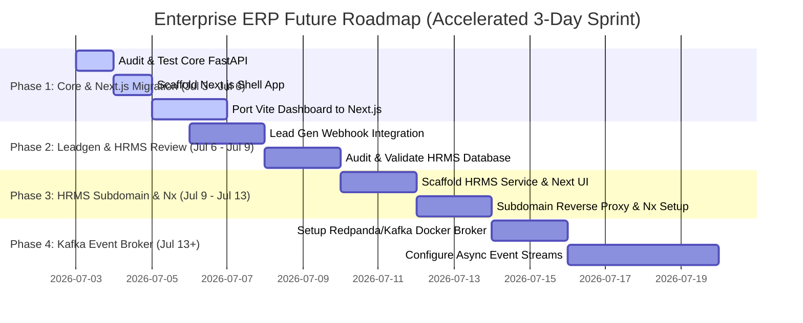

# Future Implementation Plan & Timeline: Enterprise ERP

This document outlines the strategic roadmap for scaling our enterprise ERP platform. As decided, the current strategy focuses on **stabilizing individual modules first** as standalone applications (Next.js frontend, FastAPI backend) before integrating them under **Nx monorepo orchestration** once they reach a stable state.

---

## 1. Architectural Strategy & Subdomain Boundaries

The system is designed around two main subdomain-isolated boundaries representing core business domains:

1. **Core ERP Module (`erp.company.local`)**:
   * **Domain Scope:** Accounts, Billing, Inventory Management, CRM, and Lead Ingestion.
   * **Frontend:** Next.js application (migrated from the current Vite-React `apps/erp-ui` app).
   * **Backend:** FastAPI backend (`services/erp-service`).
2. **HRMS Module (`hrms.company.local`)**:
   * **Domain Scope:** Employee onboarding, Profile records, Payroll settings, and Leave tracking.
   * **Frontend:** Next.js application (`apps/hrms-ui`).
   * **Backend:** FastAPI backend (`services/hrms-service`).

---

## 2. Project Roadmap

---

## 3. Phase Breakdown & Tasks

### Phase 1: Core ERP Stabilization & Next.js Migration (Accelerated Sprint: Jul 3 – Jul 6)
* **Goal:** Stabilize core FastAPI endpoints and migrate the dashboard frontend from Vite to Next.js.
* **Tasks:**
  - [x] Implement integration tests for accounting ledger balances and invoice status flows.
  - [x] Standardize local environment variables (`.env`) for database connections.
  - [x] Scaffold the Next.js layout shell under `apps/erp-ui`.
  - [x] Port dashboard cards, billing templates, and CRM pipelines from Vite-React to Next.js.
  - [x] Configure local proxy gateway to map `erp.company.local/` to the Next.js shell and `erp.company.local/api/` to the FastAPI backend.

### Phase 2: Lead Gen Integration & HRMS Review (Sprint: Jul 6 – Jul 9)
* **Goal:** Integrate Lead Generation webhook APIs into the core ERP and validate HRMS database design.
* **Tasks:**
  - [ ] Build the webhook endpoint inside the existing `erp-service` to ingest incoming leads.
  - [ ] Map lead statuses automatically to CRM Pipelines.
  - [ ] Complete architectural review and database modeling checks for the upcoming HRMS schema.

### Phase 3: HRMS Subdomain & Nx Integration (Sprint: Jul 9 – Jul 13)
* **Goal:** Spin up the HRMS module under its own subdomain and link workspaces via Nx.
* **Tasks:**
  - [ ] Scaffold FastAPI backend (`services/hrms-service`) and Next.js frontend (`apps/hrms-ui`).
  - [ ] Map Nginx local gateway rules to route `hrms.company.local` to the new module.
  - [ ] Initialize Nx monorepo workspaces and extract shared authentication middleware to `packages/auth-middleware`.

### Phase 4: Kafka Event Broker Integration (Sprint: Jul 13+)
* **Goal:** Establish event-driven async streams between `erp-service` and `hrms-service`.
* **Tasks:**
  - [ ] Deploy local Kafka/Redpanda container broker.
  - [ ] Implement `EmployeeCreated` publisher in the HRMS service.
  - [ ] Implement payroll subscriber inside the core Accounts service.
