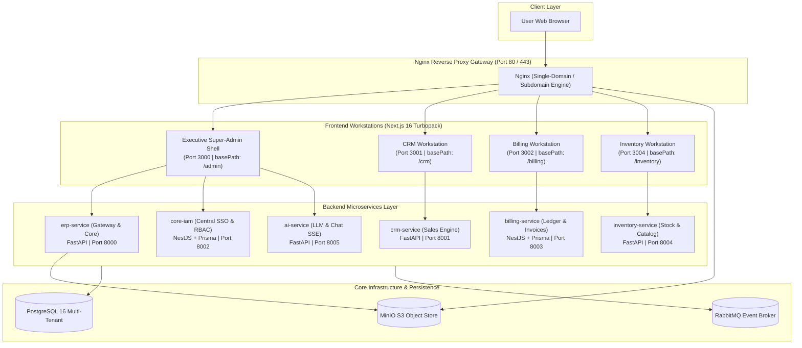
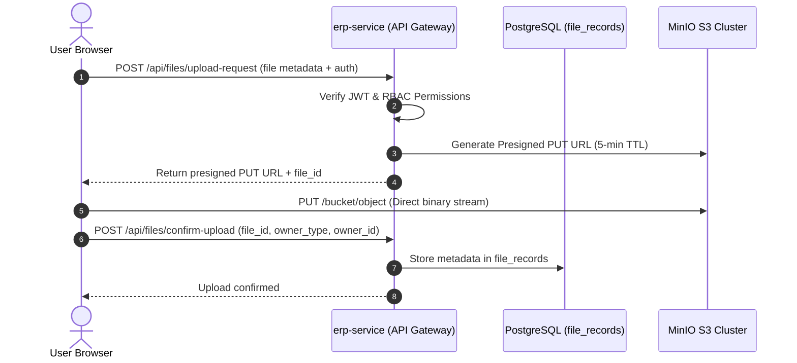

# DATAVEX ERP — Production Infrastructure & Architecture Blueprint

This document details the production-grade deployment architecture, infrastructure topology, security policies, storage strategies, and the unified **Dual Deployment Setup** (Subdomain vs. Single-Domain) for the DATAVEX ERP ecosystem.

---

## 1. Executive Summary & Infrastructure Goals

The objective is to establish an enterprise-ready, high-availability, and zero-trust infrastructure that seamlessly supports:
- **14 Docker container services**: 4 Next.js 16 frontends, 6 microservice backends, MinIO S3 object storage, PostgreSQL 16, RabbitMQ 3.12, and Nginx.
- **Dual Deployment Flexibility**: Zero-reconfiguration switching between **Mode A (Subdomain Routing)** and **Mode B (Single-Domain Path-Based Routing)**.
- **Zero Hardcoded Secrets**: Strict environment variable injection with `.env.docker` / `.env.prod` enforcement.
- **Off-VM S3 Backup Pipelines**: MinIO-driven automated database dumping and write-ahead log (WAL) archiving.
- **Presigned URL Binary Pipeline**: Direct client-to-S3 transfers with zero application gateway memory overhead.

---

## 2. System Architecture & Service Topology



---

## 3. Key Differences: Local vs. Production

| Aspect | Local Sandbox (`infrastructure/local`) | Production (`infrastructure/prod` / `internal`) |
| :--- | :--- | :--- |
| **Postgres Tuning** | Default configuration, shared storage | `shared_buffers=256MB`, `work_mem=4MB`, `max_connections=100`, WAL archiving |
| **Secrets & Keys** | Interpolated via `.env.docker` | External secret store or encrypted `.env.prod` (never committed) |
| **TLS / SSL** | HTTP only (port 80) | HTTPS termination via Let's Encrypt / ACM, HTTP $\rightarrow$ HTTPS redirect |
| **Port Exposure** | Internal services bind locally for debugging | Only 80/443 exposed to host; all microservices strictly on Docker bridge |
| **Backups** | Manual | Daily `pg_dumpall` + WAL archiving + MinIO S3 mirroring |
| **Healthchecks** | Standard Node/Python HTTP checks | Extended healthchecks with automated retry and restart policies |
| **Restart Policy** | `unless-stopped` | `unless-stopped` + CPU/RAM resource limits per container |
| **Logging** | stdout/stderr | Structured JSON logs + rotation (`max-size: 50m`, `max-file: 5`) |
| **Rate Limiting** | None | Nginx `limit_req_zone` on `/api/auth/*` brute-force mitigation |
| **CORS Policy** | Permissive (`*` or local domain) | Restricted to authorized production domains |

---

## 4. Production Database Configuration & Backup Strategy

### 4.1 PostgreSQL Tuning (`postgres/postgresql.conf`)

```conf
# ── Memory Configuration ────────────────────────────────────────────────
shared_buffers = 256MB          # 25% of RAM for small VM / 2GB for 8GB VM
effective_cache_size = 512MB
work_mem = 4MB
maintenance_work_mem = 64MB

# ── Write-Ahead Logging (WAL) & PITR ───────────────────────────────────
wal_level = replica             # Enable Point-in-Time Recovery (PITR)
archive_mode = on
archive_command = 'test ! -f /backups/wal_archive/%f && cp %p /backups/wal_archive/%f'
max_wal_senders = 3
wal_keep_size = 256MB

# ── Connection Management ──────────────────────────────────────────────
max_connections = 100
superuser_reserved_connections = 3

# ── Query Logging & Auditing ────────────────────────────────────────────
log_destination = 'stderr'
logging_collector = on
log_directory = '/var/log/postgresql'
log_filename = 'postgresql-%Y-%m-%d.log'
log_rotation_age = 1d
log_rotation_size = 100MB
log_min_duration_statement = 500  # Log slow queries exceeding 500ms

# ── Checkpoint Optimization ─────────────────────────────────────────────
checkpoint_completion_target = 0.9
wal_compression = on
```

### 4.2 Database Isolation Matrix

Each business module operates against its own dedicated database catalog within the PostgreSQL cluster:

| Database | Service Owner | Primary Schemas / Models |
| :--- | :--- | :--- |
| `erp_iam` | `core-iam` (NestJS) | `users`, `roles`, `permissions`, `organizations`, `refresh_tokens` |
| `erp_db` | `erp-service` (FastAPI) | `clients`, `leads`, `products`, `file_records`, `system_audits` |
| `erp_crm` | `crm-service` (FastAPI) | `customers`, `leads`, `quotations`, `sales_orders`, `opportunities` |
| `erp_billing` | `billing-service` (NestJS) | `invoices`, `payments`, `credit_notes`, `debit_notes`, `recurring` |
| `erp_inventory`| `inventory-service` (FastAPI)| `products`, `warehouses`, `stock`, `movements`, `purchase_orders` |
| `erp_ai` | `ai-service` (FastAPI) | `ai_sessions`, `ai_messages`, `ai_audit_logs` |

### 4.3 Automated Backup & Restore Pipeline

> [!TIP]
> Docker volumes live on the host filesystem. If the VM storage corrupts, all data is lost. Automated daily dumps are mirrored directly to MinIO bucket `erp-backups`.

```bash
#!/bin/bash
# scripts/backup.sh — Full Multi-Database Backup & MinIO Mirror
set -euo pipefail

BACKUP_DATE=$(date +%Y/%m/%d)
BACKUP_DIR="/backups/${BACKUP_DATE}"
mkdir -p "${BACKUP_DIR}"

DATABASES=("erp_iam" "erp_db" "erp_crm" "erp_billing" "erp_inventory" "erp_ai")

# 1. Dump individual logical databases
for DB in "${DATABASES[@]}"; do
    echo "Dumping database: ${DB}..."
    pg_dump -h postgres -U postgres -d "${DB}" | gzip > "${BACKUP_DIR}/${DB}.sql.gz"
done

# 2. Dump global roles and tablespaces
pg_dumpall -h postgres -U postgres --globals-only | gzip > "${BACKUP_DIR}/globals.sql.gz"

# 3. Archive WAL files
tar -czf "${BACKUP_DIR}/wal_archive.tar.gz" -C /backups wal_archive/

# 4. Mirror to MinIO off-VM backup bucket
mc alias set local_minio http://minio:9000 "${MINIO_ROOT_USER}" "${MINIO_ROOT_PASSWORD}"
mc mirror "${BACKUP_DIR}" "local_minio/erp-backups/${BACKUP_DATE}" --overwrite

# 5. Prune local files older than 7 days
find /backups -maxdepth 2 -type d -mtime +7 -exec rm -rf {} +
```

---

## 5. MinIO S3 Object Storage Architecture

MinIO serves as the enterprise-wide S3-compatible storage cluster for unstructured documents, attachments, and backups.



### 5.1 Per-Domain Bucket Strategy

| Bucket Name | Domain | Payload Types | Lifecycle Policy |
| :--- | :--- | :--- | :--- |
| `crm-assets` | CRM Workstation | Client NDAs, proposals, lead attachments, quote PDFs | Permanent (versioned) |
| `inv-docs` | Inventory Workstation| Proof of Delivery (POD), GRN inspection sheets, packing slips | Permanent (versioned) |
| `finance-records`| Billing Workstation | Generated invoice PDFs, receipt vouchers, debit notes | Permanent (versioned) |
| `erp-backups` | Infrastructure | Automated `.sql.gz` database dumps, WAL archives | 7-day automated pruning |

### 5.2 Presigned URL Pattern (Zero Backend Memory Overhead)

Binary files never pass through application servers. The client uploads/downloads directly from MinIO using time-limited presigned URLs.

- **Upload Request**: Client sends metadata to `POST /api/files/upload-request` $\rightarrow$ API Gateway validates JWT and returns presigned PUT URL (expires in 5 min).
- **Direct Upload**: Client streams binary data directly to MinIO endpoint.
- **Confirmation**: Client calls `POST /api/files/confirm-upload` $\rightarrow$ API Gateway records metadata in PostgreSQL `file_records` table.
- **Download**: Client requests `GET /api/files/:id/download` $\rightarrow$ API Gateway returns 302 Redirect to a presigned GET URL (expires in 5 min).

---

## 6. The Dual Deployment Architecture

DATAVEX ERP supports two production deployment models using a unified codebase and clean Docker Compose overrides.

```
┌─────────────────────────────────────────────────────────────────────────────────┐
│                                DUAL DEPLOYMENT SETUP                            │
├───────────────────────────────────────┬─────────────────────────────────────────┤
│    MODE A: Subdomain Routing          │     MODE B: Single-Domain Routing       │
│    (Recommended for Enterprise DNS)   │     (Recommended for Single-Host/IP)    │
├───────────────────────────────────────┼─────────────────────────────────────────┤
│  http://app.erp.local                 │  http://erp.local/admin  (basePath)     │
│  http://crm.erp.local                 │  http://erp.local/crm    (basePath)     │
│  http://billing.erp.local             │  http://erp.local/billing(basePath)     │
│  http://inventory.erp.local           │  http://erp.local/inventory(basePath)   │
│  http://minio.erp.local               │  http://erp.local/minio/ (S3 REST API)  │
│  http://minio.erp.local:9001          │  http://erp.local/minio-client (Console)│
└───────────────────────────────────────┴─────────────────────────────────────────┘
```

---

### 6.1 Mode A: Subdomain Routing (`*.erp.local` or `*.domain.com`)

In Mode A, each workstation operates at the root path (`/`) of its own dedicated subdomain.

#### Endpoint Topology
- **Executive Super Admin Shell**: `http://app.erp.local`
- **CRM Workstation**: `http://crm.erp.local`
- **Billing Workstation**: `http://billing.erp.local`
- **Inventory Workstation**: `http://inventory.erp.local`
- **MinIO S3 Gateway**: `http://minio.erp.local`

#### SSO & Cookie Strategy
- The authentication token is stored with wildcard domain scope: `Domain=.erp.local; Path=/; HttpOnly; SameSite=Lax`.
- All workstations share the session cookie across subdomains transparently.
- When an unauthenticated user opens `http://crm.erp.local`, they are redirected to `http://app.erp.local/login?redirect=http://crm.erp.local`.

---

### 6.2 Mode B: Single-Domain Path-Based Routing (`http://erp.local` or `http://domain.com`)

In Mode B, all applications and services are served under a single domain name or IP address, partitioned cleanly by path prefixes.

> [!IMPORTANT]
> **Executive Shell Isolation (`/admin`)**:
> In single-domain mode, `erp-shell` runs with `basePath: /admin`. This guarantees that internal admin routes (`/admin/crm/leads`, `/admin/billing/invoices`) never conflict with dedicated workstation root mounts (`/crm`, `/billing`, `/inventory`).

#### Endpoint Topology & URL Map

| Route / Path | Target Container | Purpose |
| :--- | :--- | :--- |
| `http://erp.local/` | Nginx Redirect | `302 Found` $\rightarrow$ `/admin` |
| `http://erp.local/login` | Nginx Redirect | `302 Found` $\rightarrow$ `/admin/login` |
| `http://erp.local/dashboard` | Nginx Redirect | `302 Found` $\rightarrow$ `/admin/dashboard` |
| `http://erp.local/admin` | `erp-shell:3000` | Executive Super Admin Shell (`basePath: /admin`) |
| `http://erp.local/admin/login` | `erp-shell:3000` | Central SSO Login Portal |
| `http://erp.local/crm` | `crm-shell:3001` | CRM Sales Workstation (`basePath: /crm`) |
| `http://erp.local/billing` | `billing-ui:3002` | Billing & Accounting Workstation (`basePath: /billing`) |
| `http://erp.local/inventory` | `inventory-ui:3004` | Inventory & Procurement Workstation (`basePath: /inventory`) |
| `http://erp.local/minio/` | `minio:9000` | S3 REST API & Presigned Object Proxy |
| `http://erp.local/minio-client` | `minio:9001` | MinIO Web Console Dashboard UI |

#### Single-Domain SSO & Authentication Flow
1. **Unauthenticated Access**: User navigates to `http://erp.local/crm`.
2. **SSO Redirect**: Workstation `AuthContext.tsx` detects unauthenticated state and redirects to `http://erp.local/admin/login?redirect=http%3A%2F%2Ferp.local%2Fcrm`.
3. **Login & Authorization**: User logs in with credentials via `core-iam:8002`.
4. **Target Redirection**: `erp-shell` validates role permissions and redirects back to `http://erp.local/crm?token=<JWT>`.
5. **Session Activation**: Workstation captures token, stores it in memory/storage, and initializes user state.

---

### 6.3 Docker Compose Implementation

The system uses standard Compose file layering:

1. **Base Configuration (`docker-compose.yml`)**:
   - Defines all 14 container definitions, networks, healthchecks, and dependency graphs.
   - Configures default Subdomain routing (Mode A).
2. **Production / Single-Domain Override (`docker-compose.prod.yaml`)**:
   - Injects `NEXT_PUBLIC_BASE_PATH: /admin`, `/crm`, `/billing`, `/inventory`.
   - Injects `NEXT_PUBLIC_DEPLOY_MODE: single-domain`.
   - Mounts `single-domain.conf` into Nginx.
   - Overrides workstation URLs to path-based addresses.

#### Execution Commands

```powershell
# ── Mode A: Subdomain Routing ──────────────────────────────────────────
# PowerShell:
.\docker-build.ps1 up -Mode subdomain

# Bash:
./docker-build.sh up --mode subdomain

# ── Mode B: Single-Domain Routing (Production Mode) ─────────────────────
# PowerShell:
.\docker-build.ps1 up -Mode prod

# Bash:
./docker-build.sh up --mode prod
```

---

## 7. Nginx Routing Engine Specifications

### 7.1 Single-Domain Nginx Configuration (`nginx/single-domain.conf`)

```nginx
worker_processes auto;
error_log /var/log/nginx/error.log warn;
pid /var/run/nginx.pid;

events {
    worker_connections 1024;
    multi_accept on;
}

http {
    include /etc/nginx/mime.types;
    default_type application/octet-stream;

    sendfile on;
    tcp_nopush on;
    tcp_nodelay on;
    keepalive_timeout 65;
    types_hash_max_size 2048;
    server_tokens off;
    resolver 127.0.0.11 valid=5s;

    # Gzip Compression
    gzip on;
    gzip_vary on;
    gzip_proxied any;
    gzip_comp_level 6;
    gzip_types text/plain text/css application/json application/javascript text/xml application/xml text/javascript;

    # WebSocket / SSE Connection Upgrades
    map $http_upgrade $connection_upgrade {
        default upgrade;
        '' close;
    }

    server {
        listen 80;
        server_name erp.local localhost;

        client_max_body_size 100m;
        proxy_buffering off;
        proxy_cache off;
        proxy_read_timeout 300s;
        proxy_send_timeout 300s;

        # ── MinIO S3 API Reverse Proxy ─────────────────────────────────
        location /minio/ {
            proxy_pass http://minio:9000/;
            proxy_http_version 1.1;
            proxy_set_header Host $http_host;
            proxy_set_header X-Real-IP $remote_addr;
            proxy_set_header X-Forwarded-For $proxy_add_x_forwarded_for;
            proxy_set_header X-Forwarded-Proto $scheme;
            proxy_set_header Upgrade $http_upgrade;
            proxy_set_header Connection $connection_upgrade;

            add_header Access-Control-Allow-Origin * always;
            add_header Access-Control-Allow-Methods "GET, PUT, POST, DELETE, OPTIONS" always;
            add_header Access-Control-Allow-Headers "*" always;

            if ($request_method = OPTIONS) {
                return 204;
            }
        }

        # ── Executive Super Admin Shell (/admin) ───────────────────────
        location /admin {
            proxy_pass http://erp-shell:3000;
            proxy_http_version 1.1;
            proxy_set_header Upgrade $http_upgrade;
            proxy_set_header Connection $connection_upgrade;
            proxy_set_header Host $host;
            proxy_set_header X-Real-IP $remote_addr;
            proxy_set_header X-Forwarded-For $proxy_add_x_forwarded_for;
            proxy_set_header X-Forwarded-Proto $scheme;
            proxy_cache_bypass $http_upgrade;
        }

        # ── CRM Workstation (/crm) ─────────────────────────────────────
        location /crm {
            proxy_pass http://crm-shell:3001;
            proxy_http_version 1.1;
            proxy_set_header Upgrade $http_upgrade;
            proxy_set_header Connection $connection_upgrade;
            proxy_set_header Host $host;
            proxy_set_header X-Real-IP $remote_addr;
            proxy_set_header X-Forwarded-For $proxy_add_x_forwarded_for;
            proxy_set_header X-Forwarded-Proto $scheme;
            proxy_cache_bypass $http_upgrade;
        }

        # ── Billing Workstation (/billing) ─────────────────────────────
        location /billing {
            proxy_pass http://billing-ui:3002;
            proxy_http_version 1.1;
            proxy_set_header Upgrade $http_upgrade;
            proxy_set_header Connection $connection_upgrade;
            proxy_set_header Host $host;
            proxy_set_header X-Real-IP $remote_addr;
            proxy_set_header X-Forwarded-For $proxy_add_x_forwarded_for;
            proxy_set_header X-Forwarded-Proto $scheme;
            proxy_cache_bypass $http_upgrade;
        }

        # ── Inventory Workstation (/inventory) ─────────────────────────
        location /inventory {
            proxy_pass http://inventory-ui:3004;
            proxy_http_version 1.1;
            proxy_set_header Upgrade $http_upgrade;
            proxy_set_header Connection $connection_upgrade;
            proxy_set_header Host $host;
            proxy_set_header X-Real-IP $remote_addr;
            proxy_set_header X-Forwarded-For $proxy_add_x_forwarded_for;
            proxy_set_header X-Forwarded-Proto $scheme;
            proxy_cache_bypass $http_upgrade;
        }

        # ── Convenience Root Redirects ─────────────────────────────────
        location = /login {
            return 302 /admin/login;
        }

        location = /dashboard {
            return 302 /admin/dashboard;
        }

        location = / {
            return 302 /admin;
        }
    }
}
```

---

## 8. Verified Healthcheck & Routing Matrix

Both deployment configurations have been verified end-to-end:

```
[VERIFICATION MATRIX]
✓ datavex-postgres         : 5432 (Healthy)
✓ datavex-rabbitmq         : 5672, 15672 (Healthy)
✓ datavex-minio            : 9000, 9001 (Healthy)
✓ datavex-core-iam         : 8002 (Healthy)
✓ datavex-billing-service  : 8003 (Healthy)
✓ datavex-erp-service      : 8000 (Healthy)
✓ datavex-crm-service      : 8001 (Healthy)
✓ datavex-inventory-service: 8004 (Healthy)
✓ datavex-ai-service       : 8005 (Healthy)
✓ datavex-erp-shell        : 3000 (Healthy - /admin)
✓ datavex-crm-shell        : 3001 (Healthy - /crm)
✓ datavex-billing-ui       : 3002 (Healthy - /billing)
✓ datavex-inventory-ui     : 3004 (Healthy - /inventory)
✓ datavex-nginx            : 80 (Active)
```

---

## 9. Next Steps for Production Rollout

1. **Let's Encrypt TLS Automation**: Set up Certbot renewal container in `infrastructure/prod/` to terminate HTTPS on port 443.
2. **Managed DB Fallback Option**: Prepare environment toggles for AWS RDS / DigitalOcean Managed PostgreSQL connection strings.
3. **Automated CI/CD Deployment**: Integrate `docker-build.sh` into GitLab CI runners with automated database migrations (`alembic upgrade head` and `prisma migrate deploy`).

